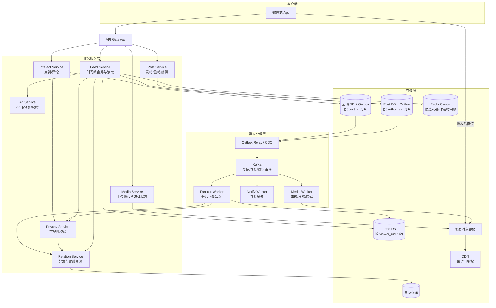
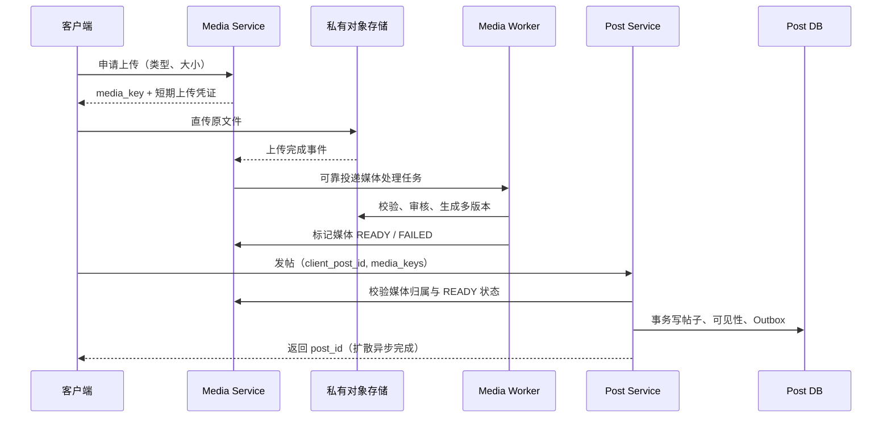
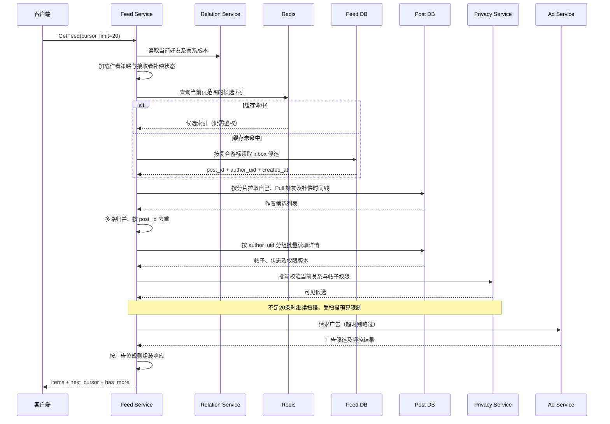

# 微信朋友圈系统设计

> **面试场景：** 腾讯 / 抖音 / 微博 高级后端 / 架构师系统设计面试  
> **高频指数：** ⭐⭐⭐⭐⭐

## 题目背景

**面试官提问方式：**

> "请设计一个类似微信朋友圈的 Feed 流系统。用户可以发布图文动态，好友可以看到、点赞和评论。重点讲讲 Feed 流如何生成和存储，以及如何处理好友数很多的用户。"

朋友圈式产品采用**双向好友关系**，需要控制帖子及互动的可见范围。面试重点是写扩散与读扩散的取舍、隐私校验、数据组织和突发流量处理。

**本文是一套面试设计方案，不是对微信内部架构的披露。** 下列规模、好友上限、活跃窗口、批量大小和延迟目标均为设计假设；生产参数需通过业务数据和压测确定。文中的“大 V”仅指高好友数作者，与微博拥有数百万关注者的单向关系账号不同。

**规模与业务假设：**

- 日活跃用户（DAU）：9 亿；每日发帖：1 亿条
- 发帖加权平均好友数：200 人；**本题约定**好友数上限为 5000 人
- 每个日活跃用户平均每天请求 10 次 Feed，每页 20 条
- 每条动态平均产生 8 次评论或点赞
- Feed 读取 P99 目标：< 200ms；正常负载下新帖索引延迟 P99 目标：< 2s
- 最近 90 天的 Feed 索引保存在热存储；更早内容按需查询作者时间线
- 媒体大小限制示例：图片 25MB、视频 100MB；平均压缩图片大小按 200KB 估算
- 默认仅好友可见，支持部分好友可见、不给某些好友看、仅自己可见

**先区分两个维度：** 发布者的好友数与发帖频率决定扩散成本；接收者的浏览活跃度决定预写 Feed 的收益。二者不能合并成“好友少才算活跃”的定义。普通用户自行发布的营销内容仍属于普通帖子，平台投放广告则走独立广告链路。

---

## 关键指标估算

以下按十进制容量单位估算，不含副本、索引、日志和备份开销。发帖峰值系数取 10，Feed 请求峰值系数取 5，二者分别估算。

| 指标 | 估算过程 | 结果 |
|------|----------|------|
| 发帖 QPS（均值） | 1亿 / 86400 | 约 1160 QPS |
| 发帖 QPS（峰值） | 均值 × 10 | 约 1.2 万 QPS |
| 全量写扩散次数 | 1亿条 × 200好友 | 200 亿条索引/天，均值约 23.1 万条/s |
| 全量写扩散峰值 | 1.2万 × 200 | 约 240 万条索引/s |
| 仅推活跃接收者的示例 | 假设每帖活跃接收者占 60% | 120 亿条索引/天，峰值约 144 万条/s |
| Feed 请求 QPS | 9亿 × 10 / 86400 | 均值约 10.4 万 QPS，峰值约 52 万 QPS |
| 帖子元数据新增 | 1亿 × 2KB | 约 200GB/天 |
| 图片新增 | 1亿 × 3张 × 200KB | 约 60TB/天；假设每帖都有3张图，不含原图及其他版本 |
| 热 Feed 索引容量示例 | 120亿/天 × 90天 × 32B | 约 34.6TB 原始字段数据，实际存储需额外计入开销 |
| 单用户 inbox 量级示例 | 200好友 × 每好友日均0.1条 × 90天 | 约 1800 条；好友发帖频率和关系分布需实测 |
| 评论+点赞写入 QPS | 1亿 × 8 / 86400 | 均值约 9260 QPS |

“每天 90 亿次 Feed 请求”与“每次展示 20 条、约 1800 亿次帖子展示”是不同指标。不能混用请求量和展示量，也不能在后续计算中把每日 1 亿条帖子改成“9 亿用户每人每天 2 条”。

**混合策略的容量模型：**

```text
每日 Feed 索引写入量 = 各条帖子实际推送接收者数之和
峰值索引写入速率 ≈ 峰值发帖 QPS × 发帖加权平均推送接收者数
存储分片数 ≥ 峰值索引写入速率 / 单分片实测可用写入速率
```

其中，实际推送接收者数还受作者策略、接收者活跃度和可见范围影响。单分片可用吞吐必须来自对应硬件、索引、批量方式与读写混合负载的压测，并预留故障和热点余量。**全局容量估算不能证明“150 个好友是最优阈值”，也不能证明“5000 次写入必然打爆服务”。**

在本题量级下，写扩散放到异步链路，使发帖接口延迟不随好友数线性增加；异步化能削峰，但不会消除总写入量，长期消费能力仍需大于到达速率。

---

## 高层架构



**职责与读写边界：**

1. **Post Service**：校验身份与媒体状态，在同一数据库事务中写入帖子、可见性配置和 Outbox 事件；成功响应表示帖子持久化，不表示所有好友 Feed 已更新。
2. **Fan-out Worker**：根据作者策略、好友关系、接收者活跃度和可见范围，异步写入轻量索引；支持幂等、重试、限速及失败补偿。
3. **Feed Service**：合并接收者 inbox、自己的作者时间线、采用 Pull 策略的好友时间线和必要的补偿候选，读取详情并完成权限过滤，然后混入广告。
4. **Interact Service**：处理评论和点赞，也可按业务规模拆成独立服务；互动读写均需校验帖子权限。
5. **Relation / Privacy Service**：管理好友、屏蔽及帖子可见范围，承担读取时的最终权限判定。
6. **Media Service / Worker**：授权客户端直传私有对象存储，异步审核、压缩与转码，管理媒体是否可用于发帖。
7. **Ad Service**：负责广告召回、定向、预算和频控；Feed Service 负责将广告放入合适的展示位置。

这些是逻辑职责，早期可在一个应用内按模块实现，规模增长后再拆分部署。

---

## 核心设计决策

### 决策一：写扩散 vs 读扩散 vs 推拉结合

**写扩散（Push / Fanout-on-Write）：**

- 发帖后为接收者预写 `(post_id, author_uid, created_at)` 索引，不复制帖子正文及媒体。
- 接收者读取自己的 inbox，再批量查详情；读取一页只需访问少量存储分片。
- 优点是读路径较短；代价是每条帖子产生 N 次索引写入，以及异步索引延迟。

**读扩散（Pull / Fanout-on-Read）：**

- 发帖仅持久化作者帖子及可靠事件，不向接收者预写 Feed 索引。
- 接收者读取时，从相关作者时间线取候选并归并。
- 降低写放大，但增加读取扇出；可以按分片批量查询、缓存作者近期列表，并行读取，不能简单等同于“200 个好友必然执行 200 次串行 RPC”。

**本方案的推拉结合：**

| 判定维度 | 策略 | 说明 |
|----------|------|------|
| 普通作者 | Push 到活跃且有权限的好友 | 作者自身近期是否登录不决定接收者是否应获得预写索引 |
| 高好友数 / 高频发帖作者 | 根据成本选择 Pull，或仅向部分高频阅读好友 Push | 这是可选策略，不存在“到5000人就必须Pull”的硬规则 |
| 非活跃接收者 | 暂停预写 inbox，上线后 Pull 补偿 | 活跃度可用近7天登录作初始代理指标，更准确的是朋友圈阅读频率 |
| Feed 读取 | inbox + 自己及 Pull 好友的作者列表 + 补偿候选 | 合并、去重、排序，统一权限过滤 |

**策略阈值如何确定：**

- 作者好友数 F、发帖频率 P、每帖实际推送人数 A，决定写成本，约为 `P × A × 单次索引写入成本`。
- 好友读取次数、Pull 缓存命中率和批量查询能力，决定拉取成本及延迟。
- 用流量样本和压测比较两种策略是否满足容量、延迟与新鲜度目标。150 可以作为实验起点，但不是活跃定义或已证实的最优值。
- 采用不同的进入与退出阈值及冷却期，避免策略频繁切换。热窗口内的旧帖子仍按旧策略查询，或先回填再退出 Pull；不能一切换策略就遗漏旧内容。

**写扩散伪代码：**

```python
# 省略任务拆分和重试实现；每个任务携带发布时确定的策略版本
# 作者帖子始终保存在 PostDB，Feed 只是可重建索引

def fanout_post(event):
    post = load_post(event.author_uid, event.post_id)
    if post is None or post.is_deleted or post.status != PUBLISHED:
        return
    if event.delivery_mode == PULL:
        return  # Feed 读取时从作者时间线获取

    recipients = get_friends(post.author_uid)
    recipients = [uid for uid in recipients if should_push(event, uid)]
    recipients = [uid for uid in recipients if can_view_post(uid, post)]

    for shard, records in group_feed_records_by_viewer_shard(post, recipients):
        # 限制每个分片的并发和速率；(uid, post_id) 唯一键去重
        idempotent_batch_insert(shard, records)
        invalidate_or_refresh_inbox_cache(records)
```

非活跃接收者不必逐帖写入“有新帖”标记，否则标记本身仍有 O(N) 的写放大。上线时根据该接收者的补偿进度和好友时间线恢复候选即可。

**上线补偿与策略迁移：**

1. 接收者恢复活跃时进入 `CATCHING_UP` 状态，新的 Push 可以同时进行。
2. 首屏从 inbox、Pull 作者及尚未补齐的普通好友时间线获取候选；历史回填在后台分批进行。
3. 按作者时间线的可靠提交水位记录补偿进度，只在对应范围扫描并持久化完成后推进检查点；失败重试不影响正确性。
4. 回填和实时 Push 用同一唯一键去重。补偿完成后，普通好友读取恢复以 inbox 为主。
5. 超过热索引保留窗口时，按需查询历史作者帖子，不承诺一次性回填全部历史。

补偿扫描需要稳定的提交序列或变更日志水位；仅用“当前时间”推进检查点会遗漏延迟提交的数据。本文采用作者分片内事务递增的 `publish_seq`，补偿按序列范围扫描，展示仍按发布时间排序。UI 的 `(created_at, post_id)` 分页游标不能直接替代补偿检查点。

### 决策二：隐私可见性控制

支持所有好友、部分好友白名单、好友黑名单和仅自己可见。**“所有好友可见”不等于“所有人可见”**；是否好友、是否屏蔽、作者是否注销、帖子是否下架，都要参与鉴权。

本文默认关闭陌生人预览。如果产品要提供此能力，应定义独立开关和完整规则，不能仅凭“帖子发布不到3天”就放行非好友。好友可看的历史时间范围也属于独立配置。

**存储方案：** 可见性配置与帖子按 `author_uid` 放在同一分片，发布和权限变更使用本地事务。

```sql
CREATE TABLE post_visibility (
    author_uid      BIGINT NOT NULL,
    post_id         BIGINT NOT NULL,
    visibility_type TINYINT NOT NULL,     -- 1=所有好友 2=白名单 3=黑名单 4=仅自己
    uid_list        JSON,                 -- 示例存储；大名单可拆成关联表
    version         BIGINT NOT NULL,      -- 与帖子 visibility_version 同事务更新
    PRIMARY KEY (author_uid, post_id)
);
```

**服务端判断示例：**

```python
# 调用方批量加载账号状态、关系、可见性配置，避免逐条远程查询

def can_view_post(viewer_uid, post):
    if post.is_deleted or post.status != PUBLISHED:
        return False
    if not account_is_available(post.author_uid):
        return False
    if viewer_uid == post.author_uid:
        return True
    if not is_mutual_friend(viewer_uid, post.author_uid):
        return False
    if is_blocked(viewer_uid, post.author_uid):
        return False
    if not within_author_history_window(viewer_uid, post):
        return False

    vis = get_visibility(post.author_uid, post.post_id)
    if vis is None:
        return False  # 缺失配置默认拒绝
    if vis.type == VISIBILITY_ALL:
        return True
    if vis.type == VISIBILITY_WHITELIST:
        return viewer_uid in vis.uid_set
    if vis.type == VISIBILITY_BLACKLIST:
        return viewer_uid not in vis.uid_set
    return False  # 仅自己 / 未知类型
```

Fan-out 前置过滤只能节省写入，**读取时仍须鉴权**。好友删除、隐私收紧和删帖不能等待 Feed 清理完成才生效。缓存授权结果必须绑定关系及权限版本，并确保读取使用当前版本；无法确认时回源或拒绝访问，不能仅靠 30s TTL 允许继续访问。

媒体也需要私有存储、访问鉴权及适当的签名有效期；如果要求权限撤销后立即阻断后续媒体请求，应在 CDN / 媒体网关校验当前授权或撤销状态，不能仅依赖旧签名自然过期。已下载到终端的内容无法远程收回。

### 决策三：评论与点赞设计

评论、点赞附着在帖子上，按 `post_id` 分片。Feed 返回的评论和点赞列表还需做互动可见性过滤，不能因帖子可见就把所有人的互动全部返回。

```sql
CREATE TABLE comments (
    post_id          BIGINT NOT NULL,
    comment_id       BIGINT NOT NULL,
    author_uid       BIGINT NOT NULL,
    client_comment_id VARCHAR(64) NOT NULL,
    reply_to_uid     BIGINT,
    reply_comment_id BIGINT,
    content          VARCHAR(2000) NOT NULL,
    created_at       BIGINT NOT NULL,
    is_deleted       TINYINT NOT NULL DEFAULT 0,
    PRIMARY KEY (post_id, comment_id),
    UNIQUE KEY uk_comment_request (post_id, author_uid, client_comment_id),
    INDEX idx_post_created (post_id, created_at, comment_id)
);

CREATE TABLE likes (
    post_id          BIGINT NOT NULL,
    user_uid         BIGINT NOT NULL,
    created_at       BIGINT NOT NULL,
    PRIMARY KEY (post_id, user_uid)
);
```

**互动写入与通知：**

1. 鉴权后，以请求幂等键写入评论，或设置点赞状态；重复点赞不会增加计数，重复取消点赞不会重复减计数。
2. 同一事务记录实际状态变化和 Outbox 事件，持久化成功后响应。
3. Notify Worker 消费事件，向帖子作者及被回复者通知，按事件 ID 和接收者去重；通知详情同样校验当前访问权限。
4. 数据库中的互动记录是事实来源；计数可用事务内更新或可靠事件维护 Redis 缓存，避免“先 INCR、后异步写数据库”产生永久漂移。
5. 对乱序或重复事件采用版本控制 / 去重，并定期对账。一致性延迟是需要监控的目标，不能无条件承诺“误差小于1秒”。

若产品规定仅共同好友的互动可见，列表先按规则过滤；展示计数也应与该规则一致，区分全局统计与当前查看者可见统计。

### 决策四：Feed 流分页——复合游标与多路归并

Offset 深分页需要扫描并丢弃前面的记录。按时间倒序浏览更适合使用复合游标。

```sql
SELECT post_id, author_uid, created_at
FROM user_feed
WHERE uid = :viewer_uid
  AND (created_at < :last_ts
       OR (created_at = :last_ts AND post_id < :last_post_id))
ORDER BY created_at DESC, post_id DESC
LIMIT :candidate_limit;
```

- 用不可变的服务端 `created_at` 和唯一 `post_id` 构成确定排序；索引匹配 `(uid, created_at DESC, post_id DESC)`，读取成本通常接近 O(log N + K)。
- inbox 和各作者列表使用相同排序及会话上界，归并后按 `post_id` 去重。
- 权限过滤可能使一批候选不足20条，需要继续取候选，直到满足页大小、耗尽来源或达到扫描预算。
- 服务端维护各来源的扫描位置、未消费候选和必要的策略版本，用不透明游标或短期会话状态传递。不能把各来源游标推进到最后一条已抓取记录，然后丢弃尚未返回的合法候选。
- 到达扫描预算时允许返回短页和续查游标；`has_more` 表示仍可继续扫描，不能仅用“返回不足20条”判定结束。

**Snowflake 的作用与边界：** 正确配置机器 ID 并处理时钟回拨后，可提供唯一 ID 和大致时间顺序；**不保证跨机器严格按真实生成时刻单调递增**。复合游标稳定依赖排序字段不可变及 ID 唯一，不依赖全局严格递增。[Snowflake 原始实现](https://github.com/twitter-archive/snowflake/blob/b3f6a3c6ca8e1b6847baa6ff42bf72201e2c2231/src/main/scala/com/twitter/service/snowflake/IdWorker.scala)

分页还要考虑异步写扩散：会话开始时固定上界能避免新帖挤动已有页，但不能保证迟到索引不遗漏。正常刷新应重新读取近期重叠范围并去重；可靠恢复依赖前述提交水位补偿。若业务要求严格的跨页快照，需要物化候选快照或版本化读取，不能仅靠时间游标承诺。

### 决策五：图片存储与多分辨率策略

客户端通过授权直传对象存储，避免图片 Base64 经过发帖服务造成额外带宽和内存开销。



**媒体与 CDN 策略：**

- 生成原图、Feed 展示图和缩略图，例如 960px / 200px；尺寸属于可配置参数。
- URL 使用不可变对象版本；内容缓存可设置较长 TTL，访问授权与内容缓存分开管理。
- 原图按需加载；多版本、原图和视频需分别计入容量与带宽。
- 视频未就绪时可以禁止发布，或提供明确的“处理中”状态；本方案采用媒体 READY 后发布。
- 只对确有收益的热点媒体预热；CDN 清理是存储治理手段，不能替代权限校验。

### 决策六：可靠事件与可重建 Feed

**发帖成功但 Kafka 事件未发送**会导致好友一直看不到帖子；“先写数据库，再发消息”存在双写失败窗口。

本方案采用事务 Outbox：帖子、权限和事件在作者分片的一个事务内提交，Relay / CDC 持续将事件送到 Kafka，失败重试。Relay 和消费者都可能重复投递，所以整个链路按至少一次处理设计，而不是假设端到端恰好一次。[Debezium Outbox 文档](https://debezium.io/documentation/reference/stable/transformations/outbox-event-router.html)

- 发帖幂等：数据库唯一键 `(author_uid, client_post_id)`；同一键不同内容需拒绝或按明确规则处理。
- 扩散幂等：Feed 唯一键 `(uid, post_id)`；批次部分成功后可安全重试。
- 任务拆分：先可靠保存或投递子任务，再提交父事件进度；不能在子任务仍仅存在于内存时确认父任务完成。
- 消费确认：写入完成后才提交对应 offset；失败进入有界重试及死信 / 补偿流程，监控待修复范围。
- 删帖和权限事件携带版本。旧发帖任务即使迟到，也不能使已删除或已撤销访问的帖子重新可见。
- 帖子和关系数据是事实来源，Feed 是派生索引，可重放或从作者时间线重建。普通读请求可短暂缺少新帖，但权限撤销不能依赖异步索引清理。

---

## 详细设计

### 数据模型与分片路由

**作者维度与接收者维度分开存储：**

- `posts`、`post_visibility` 和发帖 Outbox 按 `author_uid` 分片，同一作者的帖子形成可分页的作者时间线。
- `user_feed` 按接收者 `uid` 分片，一页候选在接收者所在分片查询。
- 详情请求携带 `(author_uid, post_id)`，按作者分片归组后批量读取；不能把分布在多个分片的帖子当作一次全局 `IN` 查询。
- 评论与点赞按 `post_id` 分片，互动服务需携带或解析作者路由以校验帖子权限。
- 分片数量由容量与扩容规划确定；下列 DDL 是逻辑表，不意味着必须固定1024个物理数据库。

```sql
CREATE TABLE posts (
    author_uid        BIGINT NOT NULL,
    post_id           BIGINT NOT NULL,       -- 唯一 ID，分片路由使用 author_uid
    publish_seq       BIGINT NOT NULL,       -- 作者内提交序列，用于补偿扫描
    client_post_id    VARCHAR(64) NOT NULL,
    content           TEXT,
    image_keys        JSON,                  -- 媒体对象标识，响应时生成授权访问凭证
    video_key         VARCHAR(512),
    location          VARCHAR(256),
    visibility_version BIGINT NOT NULL,
    status            TINYINT NOT NULL DEFAULT 1, -- 1=PUBLISHED 2=BLOCKED
    created_at        BIGINT NOT NULL,
    updated_at        BIGINT NOT NULL,
    is_deleted        TINYINT NOT NULL DEFAULT 0,
    PRIMARY KEY (author_uid, post_id),
    UNIQUE KEY uk_publish_request (author_uid, client_post_id),
    UNIQUE KEY uk_author_publish_seq (author_uid, publish_seq),
    INDEX idx_author_created (author_uid, created_at DESC, post_id DESC)
);

-- 发帖事务锁定作者状态行、递增序列并写入帖子，事务提交后水位才可见
CREATE TABLE author_publish_state (
    author_uid        BIGINT NOT NULL,
    last_publish_seq  BIGINT NOT NULL DEFAULT 0,
    PRIMARY KEY (author_uid)
);

CREATE TABLE user_feed (
    uid               BIGINT NOT NULL,       -- 接收者，也是分片键
    post_id           BIGINT NOT NULL,
    author_uid        BIGINT NOT NULL,       -- 详情路由及好友关系校验
    created_at        BIGINT NOT NULL,       -- 帖子发布时间，不是扩散完成时间
    PRIMARY KEY (uid, post_id),
    INDEX idx_uid_created (uid, created_at DESC, post_id DESC)
);

-- 与帖子共分片；互动数据库配置同类本地 Outbox
-- 表结构为示意，Relay / CDC 字段映射需按实际实现配置
CREATE TABLE outbox_events (
    event_id          BIGINT NOT NULL,
    author_uid        BIGINT NOT NULL,
    post_id           BIGINT NOT NULL,
    event_type        VARCHAR(32) NOT NULL,
    payload           JSON NOT NULL,         -- 事件版本、扩散策略等
    created_at        BIGINT NOT NULL,
    PRIMARY KEY (event_id)
);

-- 无向好友关系的规范化事实记录，每对关系只存一条
CREATE TABLE friendships (
    uid_a             BIGINT NOT NULL,       -- 较小 uid
    uid_b             BIGINT NOT NULL,       -- 较大 uid
    status            TINYINT NOT NULL,      -- 1=好友 0=已解除
    version           BIGINT NOT NULL,
    created_at        BIGINT NOT NULL,
    PRIMARY KEY (uid_a, uid_b),
    INDEX idx_uid_b (uid_b, uid_a)
);
```

补偿读取先捕获各作者已提交的 `last_publish_seq` 上界，再按 `publish_seq` 扫描至该上界；每个接收者的补偿检查点由 Feed 服务单独持久化，成功写入后推进。作者状态行与帖子、权限及 Outbox 在同一分片事务内更新，避免序列先分配而帖子迟到提交造成检查点越过缺口。权限放宽及关系变化仍需要独立事件触发旧帖重检，发布序列只覆盖新增帖子。

关系服务可另建按 `uid` 分片的双向邻接索引供好友列表查询；它与“一对关系一条事实记录”是不同存储职责。解除好友及屏蔽需要更新权威状态，并使旧授权失效，不能只等邻接列表的缓存过期。

若坚持将帖子正文按 `post_id` 分片，则必须额外维护按作者分片的时间线索引，并处理索引可靠更新与读取延迟；正文分片内的 `author_uid` 二级索引不会自动解决跨分片查询。

### Feed 流读取时序



**缓存边界：** 首屏候选、作者近期时间线和详情可分别缓存。第一页缓存不能直接复用于历史页；后续页需按游标范围查询。Push 写入、删帖与策略迁移触发候选缓存更新或失效；缓存不可用时有受限回源。最终响应始终校验当前权限，不能直接返回缓存中的完整 Feed。

### 核心 API

以下为接口示意，`Post`、`Ad` 等领域消息略去字段。调用者身份从网关认证上下文获取，不能信任客户端传入的 `author_uid` 或 `viewer_uid`。

```protobuf
rpc PublishPost(PublishPostRequest) returns (PublishPostResponse) {}
rpc GetFeed(GetFeedRequest) returns (GetFeedResponse) {}

message PublishPostRequest {
    string client_post_id = 1;
    string content = 2;
    repeated string image_keys = 3;
    string video_key = 4;
    VisibilityConfig visibility = 5;
}

message PublishPostResponse {
    int64 post_id = 1;
    int64 created_at = 2;
}

message VisibilityConfig {
    int32 type = 1;                  // 1=好友 2=白名单 3=黑名单 4=仅自己
    repeated int64 uid_list = 2;
}

message GetFeedRequest {
    string cursor = 1;              // 服务端生成的不透明游标，首次为空
    int32 limit = 2;                // 默认20，服务端限制最大值
}

message FeedItem {
    oneof item {
        Post post = 1;
        Ad ad = 2;
    }
}

message GetFeedResponse {
    repeated FeedItem items = 1;
    string next_cursor = 2;
    bool has_more = 3;
}
```

游标绑定请求用户、排序上界及归并状态，并做完整性校验；过期后客户端重新刷新。广告的分页去重、曝光记录和频控独立维护，不用广告位置推进自然帖子的游标。

---

## 常见故障与处理

以下是需要演练的故障场景，不代表真实微信生产事故。

### 问题一：高好友数作者集中发帖，扩散成本激增

某作者有5000个好友，一条帖子最多产生5000条接收者索引。风险取决于并发作者数、发帖频率、每片负载和处理方式；5000次分散索引写入不等于某一数据库行的热点，也不意味着一定超载。

**处理方式：**

1. 根据成本选择 Pull 或混合模式；采用 Push 时只预写满足活跃及权限条件的接收者。
2. 先按接收者存储分片归组，再拆成有界批次，例如每批100～500条，并在目标分片内批量插入。
3. 对各分片独立控制并发、速率和重试退避。增加 Worker 不应突破数据库写入预算。
4. 子任务可靠持久化后再确认父事件，部分失败按唯一键幂等重试；错误不能因使用 `INSERT IGNORE` 被静默掩盖。
5. 切换 Pull 时同时更新读路径并保留旧策略范围，确保热窗口内的帖子仍可查询。

### 问题二：节假日 Kafka 消费积压

当事件到达速率或每个事件的扩散工作量上升，消费者可能跟不上。一个发帖事件可能生成几条，也可能生成几千条索引，消息条数不能完整代表待处理成本。

**分层处理：**

1. **扩容 Fan-out Worker**：以 consumer lag、最老待处理事件年龄和预计剩余写入量判断压力，用 KEDA 或接入自定义/外部指标的 HPA 扩容消费者 Pod；需同时准备集群计算资源和下游写入预算。[KEDA Kafka scaler](https://keda.sh/docs/2.21/scalers/apache-kafka/)、[Kubernetes HPA](https://kubernetes.io/docs/concepts/workloads/autoscaling/horizontal-pod-autoscale/)
2. **规划消费并行度**：传统 Kafka consumer group 中一个分区同时归一个消费者消费，有效并行度受分区数限制。分区不足时可提前增加，例如64到256，但不是节假日必需的固定配置；增加分区不会重新分配已有消息，旧分区积压仍需原分区消费者处理。
3. **保护顺序语义**：增加分区可能改变 key 到分区的映射。对需要顺序的状态更新采用业务版本校验或受控迁移，不能假设扩分区前后同一 key 的全局顺序保持不变。[Kafka 运维文档](https://kafka.apache.org/42/operations/basic-kafka-operations/)
4. **仅在 Broker 成为瓶颈时扩容 Kafka**：检查磁盘、网络、复制和吞吐，再增加 Broker，并通过分区重分配使用新容量；仅增加 Broker 不会自动提高下游数据库的写入能力。
5. **降级但不丢任务**：降低预写范围、暂停非关键通知、对最近帖子执行受限 Pull 补偿；优先处理新帖需独立任务队列或显式调度。不能直接跳过未完成的旧消息并提交 offset，除非旧任务已可靠转移到可重放的补偿系统。

扩容和迁移涉及重平衡及恢复时间。节假日前应做容量预热和故障压测，避免只依赖突发流量到来后的被动扩容。

### 问题三：删帖后 Feed 索引残留

1. 在权威帖子状态中提交软删除或下架，同时产生可靠事件；读取时根据最新状态过滤。
2. 失效详情及权限缓存，异步删除相关 Feed 索引和清理媒体。清理完成时间与内容停止可见时间是不同指标。
3. 若旧扩散任务迟到而重新写入索引，读取校验仍阻止展示；后台清理与重建任务最终移除残留。
4. 服务端过滤后补取候选，不返回空白卡片；客户端容错只是最后一道体验保护。

### 问题四：隐私过滤与跨分片查询拖慢读取

实际瓶颈常来自逐帖远程查询、读取分片数和缓存未命中，不能仅凭20条帖子乘500次比较就认定 CPU 是主因。

1. 批量读取关系及可见性配置，按作者分片归组查询详情，限制并行度及超时。
2. 白名单按版本缓存为 HashSet；构建集合仍有 O(N) 成本，复用集合才可减少重复工作。
3. 权限缓存必须验证当前版本；配置缺失、版本不确定或权威校验失败时默认拒绝，不能使用过期授权结果。
4. Fan-out 前置过滤减少候选和写入，但不替代读取鉴权；授权收紧后及时撤销，授权放宽后按需补齐候选。

---

## 扩展考点

### 追问方向

**1. 如何控制好友评论和点赞的可见性？**

- 先验证查看者能访问帖子，再按产品规则展示自己、作者及共同好友的互动。
- 批量获取当前关系，过滤评论、回复对象及点赞列表；被隐藏的互动内容不能在通知预览中泄露。
- 计数是否展示全局值、评论是否保留隐藏回复的占位，需要事先明确；本方案按查看者可见范围展示。

**2. 位置分享与“附近帖子”如何设计？**

- 位置分享可存粗粒度地点及经纬度，精度由隐私策略控制。
- 附近查询用 GeoHash 或其他地理索引召回，再做精确距离过滤；GeoHash 前缀不是精确圆形范围，还需覆盖相邻网格。
- 附近帖子是额外产品能力；默认好友帖子不能因为地理位置接近就对陌生人公开。

**3. 如果产品要增加访问记录？**

- 本题默认不提供“谁看过”功能；新增能力需明确知情、权限及保留期。
- 可采用异步事件、按帖子和时间分桶、仅保留最近 N 个访问者；是否需要专用 KV / 列存由实际规模决定。
- 避免每次查看都更新帖子主表中的同一计数行。

**4. 平台广告如何插入？**

- Ad Service 在读请求中根据画像、预算、频控和上下文召回广告；Feed Service 按广告位规则混入。
- 广告不预写到每个接收者的自然帖子 `user_feed`；广告更新不触发全量 Feed 重写。
- 广告明确标识，曝光和点击用独立事件链路记录，并做事件去重；同一分页会话避免重复插入同一广告。
- 广告召回使用独立超时预算，失败时仍返回自然帖子；“每10条插1条”只是可配置规则示例。
- 普通用户发布的营销帖子仍走发帖和好友可见性规则，不自动变成平台广告。

### 边界 Case

| Case | 处理方式 |
|------|----------|
| 用户注销 | 权威账号状态立即禁止内容访问；批量软删除与 Feed / 媒体清理异步进行 |
| 网络中断后重复发帖 | 唯一键 `(author_uid, client_post_id)` 返回原结果，重复请求不能再产生一条帖子 |
| 新加好友 | 根据产品历史可见规则拉取可见帖子；不能默认新好友获得全部历史 |
| 删除好友 / 屏蔽 | 更新权威关系并撤销授权，再异步清理 Feed；旧缓存不作为放行依据 |
| 修改帖子可见范围 | 权限版本与帖子版本同事务更新；收紧权限即时校验，放宽权限补偿新接收者 |
| 举报下架 | 更新 `status=BLOCKED` 并撤销媒体访问；CDN 清理及 Feed 清理异步进行 |
| 扩散事件重复、乱序 | Feed 唯一键去重，状态版本阻止旧事件覆盖新状态，失败可重放 |
| Pull 作者数量过多 | 缓存作者近期列表、按分片批量查询，重新评估是否对高频接收者物化 inbox |
| 明星帖子互动峰值 | 首先按本题可见受众约束估算；若扩展到公开关注关系，再考虑分桶计数和分桶互动存储 |

### 演进路径（建议方案，不代表微信演进史）

```text
Phase 1（业务初期）：
  - 模块化应用 + MySQL，媒体直接使用对象存储
  - 帖子与作者时间线同源，可先用 Pull 或受限异步 Push
  - 先完成鉴权、请求幂等和可靠事件

Phase 2（读写负载增长）：
  - Kafka + Fan-out Worker，活跃接收者 inbox
  - 按作者 / 接收者分别分片，候选及详情缓存
  - 观测索引延迟、数据库负载和扩散失败

Phase 3（分布倾斜与大规模）：
  - 作者策略分级，Push / Pull 混合、补偿及策略迁移
  - 分片限速、消费者弹性扩容、冷热存储分层
  - 通过压测评估专用 Timeline / KV 存储，不能由 DAU 直接推出必须自研

Phase 4（多地域与韧性）：
  - 明确跨地域复制延迟与隐私撤销语义
  - 就近读取、容量预热、故障演练及重建验证
```

### 监控与告警指标

以下阈值是初始示例，需按 SLO、单条事件成本及基线调整。

| 指标 | 类型 | 初始告警示例 | 说明 |
|------|------|-------------|------|
| `fanout_queue_lag` | Gauge | 持续增长且最老任务超时 | 积压条数需结合每条事件扩散量判断 |
| `fanout_oldest_event_age_seconds` | Gauge | > 5s 持续1分钟 | 最老待处理任务年龄，覆盖重试和子任务队列 |
| `fanout_pending_index_writes` | Gauge | 超出预计恢复时间预算 | 估算待写索引量，比消息条数更接近实际成本 |
| `feed_cache_hit_ratio` | Gauge / 由 Counter 计算 | < 85% 持续5分钟 | 原始命中与请求计数为 Counter，命中率本身不是 Counter |
| `feed_request_latency_ms` | Histogram | P99 > 200ms | 完整 Feed 读取延迟，包括多路合并与权限校验 |
| `post_visibility_filter_latency_ms` | Histogram | P99 > 30ms | 权限校验子预算，避免占满总读取预算 |
| `cdn_origin_request_ratio` | Gauge / 由 Counter 计算 | 明显偏离基线 | CDN 回源比例，需区分内容缓存和授权校验 |
| `comment_notification_delay_ms` | Histogram | P99 > 3000ms | 通知延迟与帖子可见性是不同指标 |
| `new_post_index_delay_ms` | Histogram | P99 > 2000ms | 正常负载下发帖到 Push 索引可读的延迟 |
| `outbox_oldest_unpublished_age_seconds` | Gauge | > 5s 持续1分钟 | 数据库已提交但尚未可靠投递的事件 |
| `fanout_dead_letter_total` | Counter | 出现新增即告警 | 失败任务需有责任归属与补偿闭环 |

---

## 面试评分维度

| 维度 | 基础分（60分） | 加分项（80+分） | 满分项（100分） |
|------|----------------|-----------------|-----------------|
| **Fan-out 策略** | 解释写扩散与读扩散 | 区分作者成本和接收者活跃度，提出混合策略 | 说明阈值压测、上线补偿、策略迁移及索引重建 |
| **容量估算** | 算出基础读写 QPS | 区分消息数、索引写入数及展示量 | 使用统一假设估算有效扩散量、热点及故障余量 |
| **隐私过滤** | 服务端判断可见范围 | 校验当前好友、屏蔽、删帖及互动权限 | 明确权限版本、撤销语义、媒体鉴权和缓存边界 |
| **分页设计** | 使用游标代替深 offset | 用不可变复合排序键，多路归并与去重 | 处理过滤补取、来源进度、迟到索引及快照边界 |
| **图片存储** | 对象存储 + CDN | 直传、多版本、媒体 READY 状态 | 区分内容缓存和访问授权，说明失败及撤销处理 |
| **高可用设计** | 使用缓存和消息队列 | Outbox、至少一次消费、幂等和重试 | 说明部分失败、子任务确认、死信补偿及重建验证 |
| **扩展性思考** | 说明分片与弹性扩容 | 区分作者/接收者路由和 Worker/Broker 扩容 | 说明分区限制、顺序语义、下游背压及受控降级 |

## 技术参考与适用边界

- [Kafka Basic Operations](https://kafka.apache.org/42/operations/basic-kafka-operations/)：分区扩展、已有数据分布及 Broker 容量迁移。
- [KEDA Apache Kafka scaler](https://keda.sh/docs/2.21/scalers/apache-kafka/)：基于消费积压扩容应用，以及分区数对副本数的限制。
- [Kubernetes Horizontal Pod Autoscaling](https://kubernetes.io/docs/concepts/workloads/autoscaling/horizontal-pod-autoscale/)：HPA 自定义及外部指标支持。
- [Debezium Outbox Event Router](https://debezium.io/documentation/reference/stable/transformations/outbox-event-router.html)：可靠事件发布及事件去重。
- [Twitter Snowflake 原始实现](https://github.com/twitter-archive/snowflake/blob/b3f6a3c6ca8e1b6847baa6ff42bf72201e2c2231/src/main/scala/com/twitter/service/snowflake/IdWorker.scala)：ID 位布局及时间回拨处理。

上述资料支持相应技术机制，不证明微信采用本文的服务划分、策略阈值、存储系统或规模数字。
